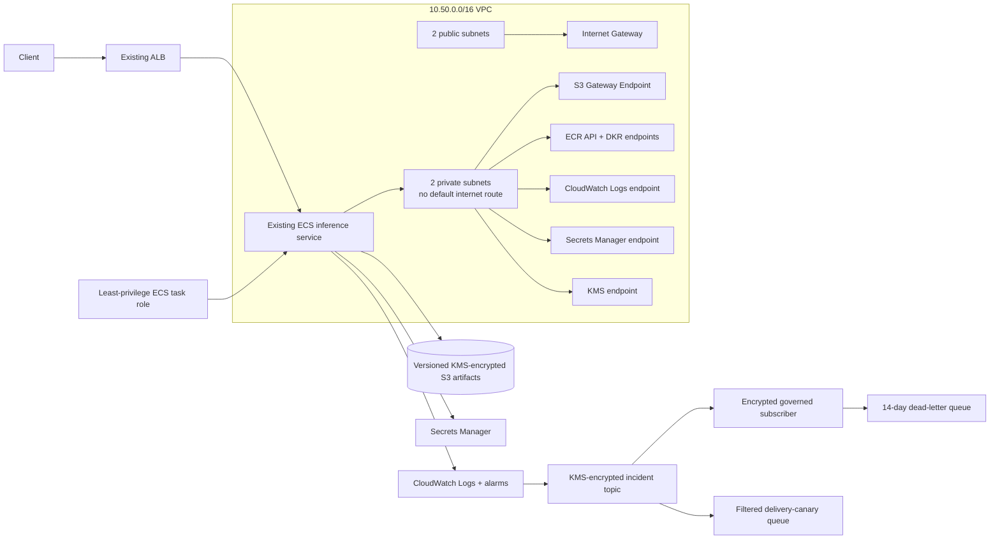

# AWS ML Platform

A credential-free, Terraform-validated reference for the infrastructure boundary around a production ML inference service on AWS.

> Portfolio reference implementation only. The Terraform models networking, artifact security, runtime IAM, autoscaling and operational signals; it deliberately accepts an existing ECS cluster/service and ALB dimension instead of pretending this small repository provisions an entire production organization.

## Implemented architecture



## What is implemented

### Private networking

`infra/networking.tf` creates:

- one VPC with DNS support/hostnames;
- two public and two private subnets across available AZs;
- an Internet Gateway and public route table;
- a private route table with **no default internet route**;
- an S3 Gateway VPC endpoint;
- Interface VPC endpoints for ECR API, ECR Docker, CloudWatch Logs, Secrets Manager and KMS;
- a dedicated endpoint security group permitting HTTPS from the VPC CIDR.

The private subnet design is intentionally endpoint-driven. A workload that needs arbitrary outbound Internet access would require an explicit egress design such as NAT; this repository does not silently add one.

### Artifact security and runtime IAM

`infra/security.tf` creates:

- an S3 artifact bucket with all public-access paths blocked;
- BucketOwnerEnforced object ownership;
- S3 object versioning;
- a rotating KMS key and alias;
- KMS-backed server-side encryption with S3 bucket keys;
- a Secrets Manager secret encrypted with the same platform key;
- an ECS task role with scoped access to model objects, bucket listing, the database secret and KMS decrypt.

The task role is intentionally separate from deployment/CI identity.

### Autoscaling and operational signals

`infra/autoscaling.tf` models:

- ECS Application Auto Scaling for an externally supplied cluster/service;
- CPU target tracking at 60%;
- memory target tracking at 70%;
- a 30-day CloudWatch log group;
- ALB target 5xx alarms;
- ALB target response-time alarms;
- fail-closed SNS/Lambda type, uniqueness, Region/account and action-quota contracts for VPC alarms;
- sustained incident-consumer backlog and any dead-lettered notification alarms;
- a mandatory independent escalation action for queue-health alarm state changes;
- fail-closed SNS/Lambda action type, Region/account and CloudWatch action-quota contracts.

The ECS service and ALB are inputs because this repository focuses on reusable platform concerns rather than embedding a large monolithic stack.

## Credential-free CI

Every push and pull request runs:

```text
python -m unittest discover -s tests -v
python -m compileall -q scripts tests
terraform fmt -check -diff
terraform init -backend=false -input=false
terraform validate
terraform test
```

This verifies the route preflight and delivery-canary logic, Python syntax, formatting, provider installation,
Terraform/provider-schema coherence and mocked plan contracts without placing AWS credentials in
pull-request CI. It does **not** claim that a credential-free validation proves a live AWS
deployment will succeed.

## Deployed-route preflight

After applying the managed topic and queue, a read-only Python preflight compares the deployed
SNS/SQS boundary with the Terraform output:

```bash
terraform -chdir=infra output -json managed_network_incident_route \
  | python scripts/verify_network_incident_route.py -
```

It verifies the exact topic, consumer queue and dead-letter queue identities; KMS configuration;
CloudWatch and SNS source-policy constraints; confirmed subscription; both redrive paths; and SNS
envelope retention. The command emits machine-readable JSON and exits non-zero if any check fails.
It requires only SNS attribute/subscription reads and SQS URL/attribute reads. It never publishes,
receives, deletes or changes alarm state, so it is suitable for deployment gates that must not touch
incident traffic.

This is a control-plane preflight, not an end-to-end delivery claim. It cannot prove KMS usability,
consumer health or data-plane delivery.

## Isolated delivery canary

An optional canary closes that data-plane gap without publishing an alarm transition or reading the
production incident queue. Terraform creates a separate, five-minute-retention encrypted queue whose
SNS subscription accepts only messages carrying `route_canary=true`; the production subscription
explicitly accepts missing or non-canary attributes and therefore excludes the probe:

```hcl
enable_managed_network_incident_topic   = true
enable_network_incident_delivery_canary = true
network_incident_canary_role_arn        = "arn:aws:iam::123456789012:role/network-incident-canary"
```

Run the bounded probe with that role:

```bash
terraform -chdir=infra output -json managed_network_incident_route \
  | python scripts/run_network_incident_delivery_canary.py -
```

The probe publishes a unique correlation ID, validates the retained SNS envelope, topic identity,
message attribute and exact payload, then deletes only the matching canary delivery. Unrelated or
malformed messages are never deleted. Poll attempts and long-poll duration are bounded, and the JSON
result records the SNS/SQS message identifiers without credentials or payload dumps.

This proves the dedicated SNS→SQS delivery path and KMS usability for the runner role. It does not
force a CloudWatch alarm, exercise the production consumer queue, or prove retry/DLQ behavior.

### Environment-approved OIDC execution

The `incident-delivery-canary` workflow runs the same bounded probe on demand without storing AWS
access keys. Its required `environment` input binds the job to a GitHub Environment, so deployments
can require reviewers and restrict which branches may run the canary. Configure these non-secret
Environment variables from the applied Terraform route:

- `AWS_REGION` and the 12-digit `AWS_ACCOUNT_ID`;
- `AWS_CANARY_ROLE_ARN`, whose trust policy must restrict GitHub's OIDC `sub` claim to this repository
  and intended Environment;
- `NETWORK_INCIDENT_TOPIC_ARN`, `NETWORK_INCIDENT_QUEUE_ARN`,
  `NETWORK_INCIDENT_DLQ_ARN` and `NETWORK_INCIDENT_CANARY_QUEUE_ARN`.

The workflow validates that every ARN shares the expected partition, account and Region before it
requests credentials. The job grants GitHub only `contents: read` and `id-token: write`, exchanges
the OIDC token for a 15-minute role session, bounds credential retries and canary polling, and
serializes runs per Environment. Third-party actions are pinned to full commit SHAs.

Every started probe writes a JSON receipt and archives it for 30 days, including failed probes. The
receipt contains route and SNS/SQS message identifiers but no credentials or arbitrary message
bodies. Environment approval is enforced only when protection rules are configured in GitHub, and
the workflow still proves only the isolated canary route—not the production consumer or DLQ retry
path. A successful workflow run is runtime evidence; the credential-free pull-request CI validates
only the workflow and route-builder contracts.

## Files

```text
infra/
├── tests/            # credential-free mocked plan contracts
├── versions.tf       # Terraform/AWS provider configuration
├── variables.tf      # explicit external integration inputs
├── networking.tf     # VPC, subnets, routing and VPC endpoints
├── security.tf       # S3, KMS, Secrets Manager and IAM
├── observability.tf  # VPC Flow Logs, metrics, alarms and contributor rules
├── incident_route.tf # optional encrypted topic, governed queue and dead-letter route
├── dashboard.tf      # opt-in network incident triage dashboard
└── autoscaling.tf    # ECS scaling, logs and ALB alarms
scripts/
├── build_network_incident_canary_route.py # fail-closed Environment route builder
├── verify_network_incident_route.py # read-only deployed-route preflight
└── run_network_incident_delivery_canary.py # isolated live delivery probe
tests/
├── test_build_network_incident_canary_route.py # environment route-boundary tests
├── test_delivery_canary_workflow.py # OIDC, permissions and artifact contract
├── test_verify_network_incident_route.py # preflight unit and failure-path tests
└── test_run_network_incident_delivery_canary.py # canary isolation and deletion tests
```

## Broader AWS service map

The wider portfolio uses this validated infrastructure layer as the AWS analogue for an ML platform involving S3, ECR, ECS/EKS, SageMaker, RDS/DynamoDB, ElastiCache, Glue/Athena, SQS/SNS/EventBridge/Kinesis and CloudWatch. Those services are architectural mappings unless code exists in this repository; the bullets above are the concrete Terraform implemented here.

The repository contains no employer data, credentials or proprietary infrastructure.
