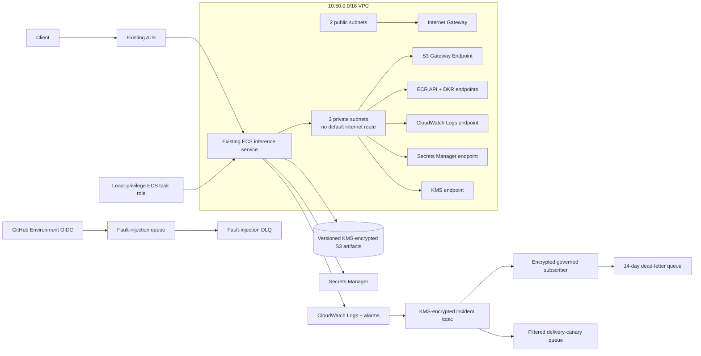

# AWS ML Platform

A credential-free, Terraform-validated reference for the infrastructure boundary around a production ML inference service on AWS.

> Portfolio reference implementation only. The Terraform models networking, artifact security, runtime IAM, autoscaling and operational signals; it deliberately accepts an existing ECS cluster/service and ALB dimension instead of pretending this small repository provisions an entire production organization.

## Implemented architecture



## What is implemented

### Private networking

`infra/networking.tf` creates:

- one VPC with DNS support/hostnames;
- two public and two private subnets across available AZs;
- an Internet Gateway and public route table;
- a private route table with **no default internet route**;
- an S3 Gateway VPC endpoint;
- Interface VPC endpoints for ECR API, ECR Docker, CloudWatch Logs, Secrets Manager and KMS;
- a dedicated endpoint security group permitting HTTPS from the VPC CIDR.

The private subnet design is intentionally endpoint-driven. A workload that needs arbitrary outbound Internet access would require an explicit egress design such as NAT; this repository does not silently add one.

### Artifact security and runtime IAM

`infra/security.tf` creates:

- an S3 artifact bucket with all public-access paths blocked;
- BucketOwnerEnforced object ownership;
- S3 object versioning;
- a rotating KMS key and alias;
- KMS-backed server-side encryption with S3 bucket keys;
- a Secrets Manager secret encrypted with the same platform key;
- an ECS task role with scoped access to model objects, bucket listing, the database secret and KMS decrypt.

The task role is intentionally separate from deployment/CI identity.

### Autoscaling and operational signals

`infra/autoscaling.tf` models:

- ECS Application Auto Scaling for an externally supplied cluster/service;
- CPU target tracking at 60%;
- memory target tracking at 70%;
- a 30-day CloudWatch log group;
- ALB target 5xx alarms;
- ALB target response-time alarms;
- fail-closed SNS/Lambda type, uniqueness, Region/account and action-quota contracts for VPC alarms;
- sustained incident-consumer backlog and any dead-lettered notification alarms;
- a mandatory independent escalation action for queue-health alarm state changes;
- fail-closed SNS/Lambda action type, Region/account and CloudWatch action-quota contracts.

The ECS service and ALB are inputs because this repository focuses on reusable platform concerns rather than embedding a large monolithic stack.

## Credential-free CI

Every push and pull request runs:

```text
python -m unittest discover -s tests -v
python -m compileall -q scripts tests
terraform fmt -check -diff
terraform init -backend=false -input=false
terraform validate
terraform test
```

This verifies the route preflight and delivery-canary logic, Python syntax, formatting, provider installation,
Terraform/provider-schema coherence and mocked plan contracts without placing AWS credentials in
pull-request CI. It does **not** claim that a credential-free validation proves a live AWS
deployment will succeed.

## Deployed-route preflight

After applying the managed topic and queue, a read-only Python preflight compares the deployed
SNS/SQS boundary with the Terraform output:

```bash
terraform -chdir=infra output -json managed_network_incident_route \
  | python scripts/verify_network_incident_route.py -
```

It verifies the exact topic, consumer queue and dead-letter queue identities; KMS configuration;
CloudWatch and SNS source-policy constraints; confirmed subscription; both redrive paths; and SNS
envelope retention. The command emits machine-readable JSON and exits non-zero if any check fails.
It requires only SNS attribute/subscription reads and SQS URL/attribute reads. It never publishes,
receives, deletes or changes alarm state, so it is suitable for deployment gates that must not touch
incident traffic.

This is a control-plane preflight, not an end-to-end delivery claim. It cannot prove KMS usability,
consumer health or data-plane delivery.

## Isolated delivery canary

An optional canary closes that data-plane gap without publishing an alarm transition or reading the
production incident queue. Terraform creates a separate, five-minute-retention encrypted queue whose
SNS subscription accepts only messages carrying `route_canary=true`; the production subscription
explicitly accepts missing or non-canary attributes and therefore excludes the probe:

```hcl
enable_managed_network_incident_topic   = true
enable_network_incident_delivery_canary = true
network_incident_canary_role_arn        = "arn:aws:iam::123456789012:role/network-incident-canary"
```

Run the bounded probe with that role:

```bash
terraform -chdir=infra output -json managed_network_incident_route \
  | python scripts/run_network_incident_delivery_canary.py -
```

The probe publishes a unique correlation ID, validates the retained SNS envelope, topic identity,
message attribute and exact payload, then deletes only the matching canary delivery. Unrelated or
malformed messages are never deleted. Poll attempts and long-poll duration are bounded, and the JSON
result records the SNS/SQS message identifiers without credentials or payload dumps.

This proves the dedicated SNS→SQS delivery path and KMS usability for the runner role. It does not
force a CloudWatch alarm, exercise the production consumer queue, or prove retry/DLQ behavior.

### Environment-approved OIDC execution

The `incident-delivery-canary` workflow runs the same bounded probe on demand without storing AWS
access keys. Its required `environment` input binds the job to a GitHub Environment, so deployments
can require reviewers and restrict which branches may run the canary. Configure these non-secret
Environment variables from the applied Terraform route:

- `AWS_REGION` and the 12-digit `AWS_ACCOUNT_ID`;
- `AWS_CANARY_ROLE_ARN`, whose trust policy must restrict GitHub's OIDC `sub` claim to this repository
  and intended Environment;
- `NETWORK_INCIDENT_TOPIC_ARN`, `NETWORK_INCIDENT_QUEUE_ARN`,
  `NETWORK_INCIDENT_DLQ_ARN` and `NETWORK_INCIDENT_CANARY_QUEUE_ARN`.

The workflow validates that every ARN shares the expected partition, account and Region before it
requests credentials. The job grants GitHub only `contents: read` and `id-token: write`, exchanges
the OIDC token for a 15-minute role session, bounds credential retries and canary polling, and
serializes runs per Environment. Third-party actions are pinned to full commit SHAs.

Every started probe writes a JSON receipt and archives it for 30 days, including failed probes. The
receipt contains route and SNS/SQS message identifiers but no credentials or arbitrary message
bodies. Environment approval is enforced only when protection rules are configured in GitHub, and
the workflow still proves only the isolated canary route—not the production consumer or DLQ retry
path. A successful workflow run is runtime evidence; the credential-free pull-request CI validates
only the workflow and route-builder contracts.

## Isolated dead-letter redrive drill

The separate `incident-redrive-canary` workflow verifies retry exhaustion without sending to,
receiving from, purging, or deleting from the production incident queue. It requires a protected
non-production Environment with two empty standard queues whose names end in `-fault-injection` and
`-fault-injection-dlq`. The source queue must have a `maxReceiveCount` from 2 through 5 and the DLQ
must use `byQueue` redrive permission scoped only to that source.

Configure these Environment variables:

- `AWS_REGION`, `AWS_ACCOUNT_ID` and `AWS_REDRIVE_CANARY_ROLE_ARN`;
- `NETWORK_INCIDENT_REDRIVE_OIDC_SUBJECT`, copied from Terraform to bind the live trust check;
- `NETWORK_INCIDENT_REDRIVE_EVIDENCE_KEY_ARN`, the dedicated asymmetric KMS key;
- optional `NETWORK_INCIDENT_REDRIVE_ARCHIVE_BUCKET` and
  `NETWORK_INCIDENT_REDRIVE_ARCHIVE_RETENTION_DAYS` values emitted by Terraform;
- `NETWORK_INCIDENT_QUEUE_ARN`, used only as the production boundary that the drill must not equal;
- `NETWORK_INCIDENT_FAULT_QUEUE_ARN` and `NETWORK_INCIDENT_FAULT_DLQ_ARN`.

The workflow validates all ARNs before requesting credentials, then exchanges GitHub OIDC identity
for a 15-minute session. Before any data-plane call, a read-only preflight verifies that the active
caller is the expected role; its live trust policy still binds the exact GitHub provider, audience
and Environment subject; its inline policy has not broadened; and both queues retain their reviewed
identity, encryption, retention, TLS-only resource policy and redrive settings. The preflight receipt
contains a queue-route commitment, a broader boundary commitment, the workflow run/attempt
authorization identifier and named check results, not ARNs or policy documents. The canary refuses
to make data-plane calls unless that receipt is passing, complete, bound to the current run and exact
queue route, and canonicalizable. Its SHA-256 commitment is embedded in both the poison payload and
the final canary receipt, linking the reviewed live boundary to the observed drill execution.

After the canary passes, the same short-lived identity asks the dedicated KMS P-256 key to sign a
canonical evidence envelope. The envelope commits to the authorization identifier, queue route,
exact preflight receipt, exact canary receipt and immutable signing-key revision. The workflow
checks the KMS signature before archiving it. The envelope contains commitments and public-key
material for independent verification, not queue ARNs, IAM documents or message bodies.

The role grants `iam:GetRole` and `iam:GetRolePolicy` only on itself for this drift gate. Its SQS
permissions remain limited to `sqs:GetQueueUrl`, `sqs:GetQueueAttributes`,
`sqs:SendMessage`, `sqs:ReceiveMessage`, `sqs:ChangeMessageVisibility` and `sqs:DeleteMessage` on the
two fault-injection queues; it needs no permission on the production queue.
The same inline policy grants only `kms:DescribeKey`, `kms:GetPublicKey`, `kms:Sign` and `kms:Verify`
on the dedicated evidence key. The key policy grants that role the same four operations.

The drill writes one uniquely correlated poison canary directly to the isolated source, repeatedly
returns only that exact message to visibility until the live bounded receive policy is exhausted,
observes the exact body in the DLQ, and deletes only the verified DLQ copy. It fails closed when the
queues are non-empty, their live identities or policies differ, receive counts do not increase, or
an unrelated message appears. The archived receipt contains the receive-count sequence, message
identifiers and a SHA-256 commitment to the route, not queue ARNs or message bodies.
It also records the SHA-256 commitment of the exact preflight receipt that authorized the run.
When the archive variables are configured, the workflow verifies live bucket versioning, exact
compliance-mode Object Lock defaults, and all four public-access blocks before uploading. The upload
uses a content-addressed, run-specific key, SHA-256 checksum, AES-256 server-side encryption and
`If-None-Match: *`; it then reads retention for the returned object version and fails unless the
version is compliance-locked for the reviewed period. The published receipt hashes the bucket,
object key and version identifier rather than exposing them. GitHub's 30-day artifact remains an
operational copy; S3 is the independently retained custody boundary.

This is an explicit failure-consumer drill, not a production-consumer test. SQS approximate queue
counts are eventually consistent. No live AWS drill is run in pull-request CI.

### Opt-in redrive prerequisites

Terraform can provision the two drill queues, dedicated asymmetric signing key and least-privilege
runner role without granting that role any permission on production traffic. The account-wide
GitHub OIDC provider remains an explicit input because silently creating or adopting a singleton
identity provider is unsafe:

```hcl
enable_network_incident_redrive_drill             = true
network_incident_redrive_production_queue_arn     = "arn:aws:sqs:eu-central-1:123456789012:ml-platform-network-incidents-consumer"
network_incident_redrive_github_oidc_provider_arn = "arn:aws:iam::123456789012:oidc-provider/token.actions.githubusercontent.com"
network_incident_redrive_github_repository        = "cagataykavas/aws-ml-platform"
network_incident_redrive_github_environment       = "redrive-staging"
enable_network_incident_redrive_evidence_archive  = true
network_incident_redrive_evidence_archive_bucket_name = "globally-unique-redrive-evidence-bucket"
network_incident_redrive_evidence_retention_days  = 30
```

The trust policy requires both GitHub's `sts.amazonaws.com` audience and the exact
`repo:owner/repository:environment:name` subject. The role can exercise only the two dedicated
queues and use the signing key only for evidence operations. Both queues use SQS-managed encryption,
TLS-only resource policies, one-hour default retention, and a receive threshold constrained to 2–5.
The DLQ admits redrive only from its paired source. The production ARN is validated in the deployment
partition, Region and account, but is used only as a distinctness boundary and never appears in the
role policy. The optional archive creates a private, versioned, AES-256-encrypted S3 bucket with a
compliance-mode default retention. The workflow role may inspect the bucket contract, append only
under `redrive-evidence/v1/`, and read that exact version's retention. It receives no delete,
retention-change, governance-bypass, object-read or bucket-administration permission.

After apply, copy the ready-to-use values into the protected Environment:

```bash
terraform -chdir=infra output -json network_incident_redrive_drill \
  | jq '.github_environment_variables'
```

Terraform cannot create GitHub Environment reviewers or branch restrictions, so those repository
settings remain a deployment prerequisite. The OIDC provider itself must already exist in the AWS
account. Queue encryption is SQS-managed rather than customer-managed to keep this isolated drill
independent from the production incident KMS boundary.

## Files

```text
infra/
├── tests/            # credential-free mocked plan contracts
├── versions.tf       # Terraform/AWS provider configuration
├── variables.tf      # explicit external integration inputs
├── networking.tf     # VPC, subnets, routing and VPC endpoints
├── security.tf       # S3, KMS, Secrets Manager and IAM
├── observability.tf  # VPC Flow Logs, metrics, alarms and contributor rules
├── incident_route.tf # optional encrypted topic, governed queue and dead-letter route
├── incident_redrive_drill.tf # opt-in isolated queues and Environment-scoped OIDC role
├── dashboard.tf      # opt-in network incident triage dashboard
└── autoscaling.tf    # ECS scaling, logs and ALB alarms
scripts/
├── build_network_incident_canary_route.py # fail-closed Environment route builder
├── build_network_incident_redrive_route.py # non-production redrive boundary builder
├── verify_network_incident_route.py # read-only deployed-route preflight
├── verify_network_incident_redrive_prerequisites.py # live IAM/SQS drift gate
├── seal_network_incident_redrive_evidence.py # KMS-signed paired evidence envelope
├── archive_network_incident_redrive_evidence.py # verified S3 Object Lock custody
├── run_network_incident_delivery_canary.py # isolated live delivery probe
└── run_network_incident_redrive_canary.py # bounded poison-message redrive drill
tests/
├── test_build_network_incident_canary_route.py # environment route-boundary tests
├── test_build_network_incident_redrive_route.py # fault-route boundary tests
├── test_delivery_canary_workflow.py # OIDC, permissions and artifact contract
├── test_redrive_canary_workflow.py # redrive workflow security contract
├── test_seal_network_incident_redrive_evidence.py # evidence binding and KMS contract tests
├── test_verify_network_incident_route.py # preflight unit and failure-path tests
├── test_run_network_incident_delivery_canary.py # canary isolation and deletion tests
└── test_run_network_incident_redrive_canary.py # bounded retry and DLQ tests
```

## Broader AWS service map

The wider portfolio uses this validated infrastructure layer as the AWS analogue for an ML platform involving S3, ECR, ECS/EKS, SageMaker, RDS/DynamoDB, ElastiCache, Glue/Athena, SQS/SNS/EventBridge/Kinesis and CloudWatch. Those services are architectural mappings unless code exists in this repository; the bullets above are the concrete Terraform implemented here.

The repository contains no employer data, credentials or proprietary infrastructure.
